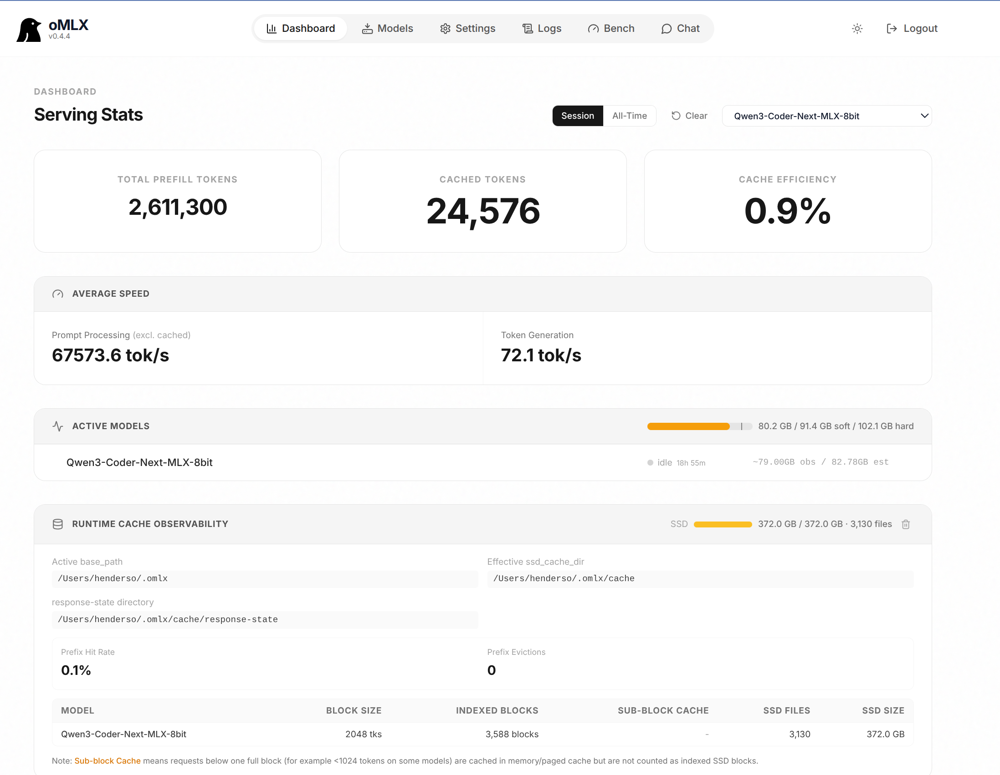

A lot of the work I do happens in places cloud LLMs can't go.
Incident writeups, reverse engineering, artifact analysis, and internal vuln-triage notes are the threat-intel workflows that would benefit *most* from an AI assistant, and they are exactly the ones where pasting text into someone else's API is not an option.
Most LLM benchmarking ignores this, because the benchmarks assume access to a hosted model like GPT.
In my world, that access often isn't available.

So the question I wanted answered was this: **how much real CTI capability can I get out of a model running entirely on hardware I own**, fully offline, with no cloud service or API key involved and nothing leaving the room?
To find out, I took the 8-bit quantized version of [Qwen3-Coder-Next](https://huggingface.co/Qwen/Qwen3-Coder-Next), served it locally with oMLX, and pointed the full 8,100-prompt AthenaBench threat-intelligence benchmark at it.
In short, it lands between Llama 3.3-70B and GPT-4 overall and beats GPT-4 outright on two of the six tasks, all while running on a laptop.

## The dataset: AthenaBench

[AthenaBench](https://arxiv.org/abs/2511.01144) (WAITI Workshop 2025) is a [benchmark](https://github.com/Athena-Software-Group/athenabench) of six CTI tasks.
What I like about it is how cleanly the tasks map onto the day-to-day work of a SOC or threat-intel team:

| Task | n | What the model must do | Metric |
| --- | --- | --- | --- |
| **CKT** (CTI Knowledge Test) | 3,000 | Five-option multiple choice on [ATT&CK](https://attack.mitre.org/), threat actors, and CTI concepts | Accuracy |
| **ATE** (ATT&CK Technique Extraction) | 500 | Read an attack scenario and identify the single best-matching technique ID (T####) | Accuracy |
| **RCM** (Root Cause Mapping) | 2,000 | Read a [CVE](https://www.cve.org/) description, identify the root-cause [CWE](https://cwe.mitre.org/) | Accuracy |
| **RMS** (Recommended Mitigations) | 500 | Recommend exactly four [ATT&CK mitigation IDs](https://attack.mitre.org/mitigations/) (M10xx) for a scenario | F1 |
| **VSP** (Vulnerability Severity Prediction) | 2,000 | Derive a full [CVSS v3.1](https://www.first.org/cvss/v3-1/) base vector from a CVE description | 1 − MAD/7.7 |
| **TAA** (Threat Actor Attribution) | 100 | Attribute an anonymized incident summary to a known threat actor | Accuracy (with alias/related-actor credit) |

Two things convinced me it is a fair test.
First, answers are extracted from free-form responses and scored mechanically (exact IDs, CVSS score deviation, and alias-aware actor matching), so no LLM judges its own output and nothing depends on subjective grading.
Second, the tasks span a real capability gradient, from pure recall (CKT), through classification (ATE, RCM, VSP), to open-ended generation (RMS) and inference under anonymization (TAA).
In my experience, local models succeed or fail along exactly that gradient.

## My setup

- **Model:** Qwen3-Coder-Next, 8-bit MLX quantization, exposed on my LAN through an OpenAI-compatible server.
  Although this is a *coding* model, I wanted to know how far its structured-output pedigree carries in a domain made up almost entirely of IDs, vectors, and taxonomies.
  If I have to bring a model into an environment, particularly a secure environment where software is burned to Blu-ray and takes effort to scan, I would prefer to bring just one that covers many tasks, like a Swiss Army knife.
- **Hardware:** a single 14-inch MacBook Pro (M5 Max with an 18-core CPU, 40-core GPU, and 16-core Neural Engine; **128GB unified memory**; 4TB SSD), serving the model through the [omlx](https://github.com/jundot/omlx) inference server, which is optimized for Apple's on-device ML runtime.
  Memory is the deciding factor: an 8-bit quant of a model this size has to sit resident in RAM, and Apple's unified-memory architecture lets the GPU address all 128GB directly.
  The whole setup is a laptop that closes and fits in a bag.
- **Generation settings:** temperature 0.0, `max_tokens` 4096.
- **Scoring:** the benchmark's own evaluator, unmodified.


*oMLX serving the benchmarked model on the laptop at about 72 tok/s generation, with cache and memory all local.*
*The entire 8,100-prompt run went through this dashboard.*

The token cap was an important lesson.
I first ran uncapped, to match how the benchmark's authors ran the OpenAI API models.
On the CVSS task the model occasionally fell into runaway generation: one response reached about 78,000 characters of circular analysis before it committed to a vector, and latency grew along with it.
So I added the 4096-token cap (in the same spirit as the harness's own 2048-token cap for HuggingFace models) and, for consistency, regenerated the VSP records that had been produced uncapped.
The full run of all 8,100 prompts *took a bit over a day on that one laptop*.

## Results

Here is the full run alongside previously published benchmark values:

| Model | CKT | ATE | RCM | RMS (F1) | VSP | TAA | Combined |
| --- | --- | --- | --- | --- | --- | --- | --- |
| GPT-5 | 92.0 | 76.0 | 71.6 | 32.6 | 85.4 | 39.0 | 66.1 |
| GPT-4o | 85.2 | 51.6 | 71.3 | 20.2 | 84.7 | 35.0 | 58.0 |
| GPT-4 | 78.7 | 35.8 | 63.1 | 15.1 | 84.7 | 31.0 | 51.4 |
| **Qwen3-Coder-Next (MLX 8-bit, local)** | **82.5** | **42.8** | **62.4** | **8.0** | **80.2** | **18.0** | **49.0** |
| Llama 3.3-70B | 81.4 | 30.4 | 60.0 | 11.1 | 70.1 | 26.0 | 46.5 |
| Qwen3-14B | 78.6 | 19.4 | 54.1 | 7.0 | 80.3 | 17.0 | 42.7 |

A locally served 8-bit model posts the strongest open-weights row on the board.
It is ahead of GPT-4 on threat-intel knowledge (CKT, +3.8) and technique extraction (ATE, +7.0), essentially tied on CVE root-cause mapping, and within five points on CVSS severity.
The two *generative* tasks, mitigation recommendations and actor attribution, keep it from closing the remaining gap to GPT-4's combined score.

## What this actually means for security work

**The classification half of CTI work is now viable on-prem.**
Technique tagging, CVE-to-CWE mapping, severity triage, and knowledge lookup all run at roughly GPT-4 level, with the data never leaving the laptop, let alone the building.
For anyone handling restricted-distribution intel, that changes the calculation.
These are the high-volume, low-judgment tasks I would automate first, and they no longer require a cloud dependency.

**Attribution usually lands close to the right actor but rarely on it exactly.**
The headline TAA number (18% exact) looks poor until the secondary metric is considered: **96% of the model's attributions were *plausible***, meaning a correct alias or an actor documented as related to the true one.
The model reliably lands in the right cluster of activity and rarely picks an outright wrong actor.
As a triage hint ("this tradecraft looks Lazarus-adjacent"), that is useful.
As an attribution *source*, relying on it would be malpractice, as it would be for any unassisted LLM doing attribution.

**I would not let a local model write mitigation guidance.**
RMS (F1 8.0) was by far the worst task, and the failure mode is the interesting part: the model can reason sensibly about defenses in free text, then miss the *specific* mitigation IDs that map to the scenario.
Every model in the table drops sharply here relative to its other scores (GPT-5 manages only 32.6), so this weakness extends to frontier models.
It is simply most acute at the small end.
***Prevention and hardening recommendations still need a human, or at the very least heavy retrieval augmentation.***

**The main operational gap is format discipline; the knowledge is largely there.**
This is the finding I keep coming back to.
In the most instructive failures, the model appeared to know the answer but did not return it in a shape I could parse.
Beyond the runaway generation, 17% of its CVSS responses contained no usable vector at all (the official scorer drops these from the deviation metric, so the VSP number should be read with that in mind).
The model frequently *knows* the answer and does not state it cleanly.
In production I would wrap it in structured-output constraints, such as JSON-schema enforcement or grammar-constrained decoding, and I expect that would recover several points at little cost.
That engineering is cheap, and in my opinion it is worth doing before concluding that a local model "can't" do a task.
In my experience it usually can, once something enforces the output format.

## Caveats

This is one run at temperature 0, on an 8-bit quantization (full precision may shift results at the margins), with a 4096-token generation cap where the published API baselines ran uncapped.
A benchmark is also always a proxy, and AthenaBench's tasks are well-shaped *imitations* of CTI work.
I treat these numbers as a strong directional signal and would not read them as definitive.

## Reproducing

Everything runs in the AthenaBench harness.
My scored outputs and the README table rows are in [my upstream PR](https://github.com/Athena-Software-Group/athenabench/pull/4).
To point it at a different local model:

```bash
# config.yaml
my-local-model:
  type: openai
  name: <model id from /v1/models>
  base_url: https://<your-server>/v1
  max_tokens: 4096

python -m athena_eval.run --mini --model my-local-model   # quick pass (950 prompts)
python -m athena_eval.run --model my-local-model          # full benchmark (8,100 prompts)
python -m athena_eval.evaluate --model my-local-model     # official scoring
```

I recommend starting with `--mini`, which predicted my full-run results within a point or two on most tasks.

## The Road Ahead

**More models, including reasoning models.**
The most surprising result here was that a *coding* model held its own on threat-intel knowledge, so the next step is to see whether that generalizes.
First up is [Qwen3.6-27B](https://huggingface.co/Qwen/Qwen3.6-27B), a dense 27B instruct model from the same family, another coding and reasoning flagship, and small enough at 8-bit to fit comfortably in the same 128GB.
It runs in "thinking mode" by default, which makes it a natural test of a question this run left open: do explicit reasoning traces *help* the inference-heavy tasks (RCM, VSP), or do they feed the runaway-generation problem I had to cap?
(I also looked closely at [Qwen-AgentWorld-35B-A3B](https://huggingface.co/Qwen/Qwen-AgentWorld-35B-A3B), but it is a base *world model* built to simulate multi-turn agent environments, which is a poor fit for AthenaBench's mechanically scored single-turn QA, so it is off the list for now.)

**Retrieval-augmented generation for the weak dimensions.**
The two tasks that pulled the combined score down, mitigation recommendations (RMS, F1 8.0) and actor attribution (TAA), fail for the same underlying reason: the model's reasoning is generally sound, but it struggles to produce the *exact* ID or actor from a large, fixed universe of options.
That is a textbook case for retrieval.
The whole system can also stay airgapped, because the knowledge the model is missing is *public*.
Here is how I would architect it:

1. **Corpus: bake the references onto the box.** The corpus holds two bodies of knowledge, both assembled offline.
   For the *mitigation* task, it holds the static taxonomies: the full [ATT&CK](https://attack.mitre.org/) knowledge base (techniques and mitigations) as STIX, the [CWE](https://cwe.mitre.org/) catalog, and the CVSS specification.
   For *attribution*, it holds a threat-actor profile corpus assembled from the CTI sources analysts already use: [ATT&CK Groups](https://attack.mitre.org/groups/), [CISA advisories](https://www.cisa.gov/news-events/cybersecurity-advisories) (the AA-series actor writeups are dense with TTPs and aliases, which is what the alias-aware TAA metric rewards), [AlienVault OTX](https://otx.alienvault.com/) pulses, and the community actor encyclopedias ([MISP galaxy](https://www.misp-project.org/galaxy.html), [Malpedia](https://malpedia.caad.fkie.fraunhofer.de/)).
   The taxonomies are essentially static, but the actor intel changes, so it is pulled as a periodic snapshot and carried across the airgap the same way signatures and feeds already are.
   All of it is public, so the airgap stays intact and the only added requirement is a refresh cadence.
2. **Index: embed locally.** Chunk and embed the corpus with a local embedding model served through omlx alongside the LLM, and store the vectors in a local index (FAISS/LanceDB).
   Nothing leaves the laptop.
3. **Retrieve + rerank.** At query time, embed the scenario, pull the top-*k* candidate mitigations (or actor profiles), and run a small cross-encoder rerank to tighten precision.
   Precision matters a lot for RMS, where the metric rewards getting *exactly four* IDs right.
4. **Constrained generation.** Inject those candidates into the prompt and constrain decoding to the valid ID space (M10xx, known actor names) with grammar- or JSON-schema-enforced output.
   This is the piece I'm most optimistic about, because it addresses *both* failure modes at once: the model gets the right candidates in front of it (knowledge) and can only emit well-formed IDs (the format-discipline gap from the last section).
5. **Wire it in without touching the scorer.** The cleanest integration is a thin retrieval proxy between the AthenaBench harness and the omlx endpoint that intercepts the prompt, runs the retrieval, injects the context, and forwards the request.
   This follows the same approach as the `base_url` swap earlier: the benchmark's scoring code is unaware of the proxy, so the comparison stays fair.

The hypothesis is straightforward.
RMS is a recall-and-format problem, and RAG plus constrained decoding turns "generate the right four IDs from memory" into "select the right four from a shortlist."
TAA looks even more promising: the model already lands in the right neighborhood 96% of the time, and retrieval over actor TTP profiles could convert those *plausible* hits into *exact* ones.
If selection judgment turns out to be the bottleneck, RAG will help less.
Either way, I'll measure it on the same harness and report what the numbers show.

For teams holding intel that cannot go to a cloud provider, my main takeaway is that the classification half of the job can already run in-house today, on hardware that fits in a bag.
